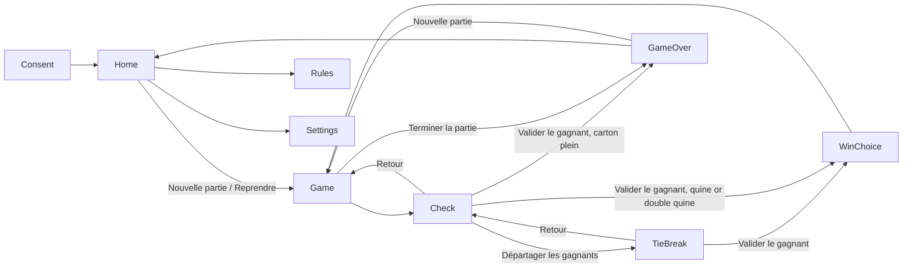

# PRD: Loto Quine

Status: approved
Project slug: loto-quine
Final app name: Loto Quine
Android package: io.github.nhilaire.lotoquine
Version target: 0.2.0
Last updated: 2026-10-25

> Written in English. Player-facing copy (French reference, English) is quoted in the "Player copy" section.
> Status becomes `approved` only after the user explicitly approves this document.

## Summary

Loto Quine turns an Android phone into the host (« l'animateur ») of a family loto evening. Players keep their own
paper cards and tokens; the phone draws the balls 1 to 90 without replacement, shows each ball big with a short
rolling animation, announces it aloud in the game's language (optionally with the traditional loto nickname, or the traditional British bingo call in English), keeps the 1-90 board
of drawn numbers, follows the three classic stages (quine, double quine, carton plein) and checks a claimed card when
someone shouts « Quine ! ». It replaces an earlier, unpublished C# console prototype with the same rules
and a much more polished, warm village-hall look.

French pitch: « Ton animateur de loto dans la poche : tire les boules, annonce-les et vérifie les cartons ! »

## Target players

- Families (children with parents and grandparents) playing together around a table, one phone acting as host.
- The host holds or lays the phone; everyone must be able to read the number from a distance and hear it.
- Session: an evening game, open-ended; one game runs from quine to carton plein, up to 90 balls per draw.
- Accessibility: very large number, ball colour always paired with the printed number (never colour alone),
  high-contrast board, voice announcement.

## Core loop

1. The host taps to draw a ball.
2. The ball rolls for about 1 s, then reveals its number; the phone announces it (voice, sound, vibration) and the
   number lights up on the 1-90 board.
3. Players mark their paper cards; repeat until someone shouts.
4. The host checks the claimed card in the app (row by row); if it wins, the host chooses to continue the same draw
   into the next stage or to start a new draw.
5. After carton plein, the game ends and a new game can start.

## Use cases

| ID | As a host I want to... | So that... |
|---|---|---|
| UC-01 | answer the anonymous statistics question on first launch | my choice is respected (GDPR) |
| UC-02 | start a new game | the family can play from the quine stage with all 90 balls |
| UC-03 | draw balls one by one with a tap | I set the pace of the evening |
| UC-04 | see and hear each ball clearly | everyone can follow, even from a distance |
| UC-05 | see all drawn numbers on a 1-90 board and the last balls in order | I can answer « il est sorti le 32 ? » |
| UC-06 | check a claimed card row by row | I know at once whether the player wins and which numbers are missing |
| UC-07 | choose, after a win, to continue the draw or start a new one | I can play the way my family likes |
| UC-08 | resume the game exactly after the app was closed or the phone slept | an interruption does not ruin the evening |
| UC-09 | turn voice, nicknames, sounds, vibrations and statistics on or off | the app fits the room and my preferences |
| UC-10 | read the rules briefly | new players understand quine, double quine and carton plein |
| UC-11 | end a game early | we can stop or start over at any time |
| UC-13 | play in my own language (French or English), following my phone or chosen in the settings | foreign family members can host too |
| UC-12 | break a tie when several players win on the same ball | exactly one winner per stage, fairly |

## Screens

- **Consent** (first launch only): explains anonymous statistics; « Accepter » and « Refuser » equally prominent.
  Then Home.
- **Home**: title « Loto Quine », pitch, « Nouvelle partie », « Reprendre la partie » (only when a game is in
  progress), « Règles », « Paramètres ».
- **Game**: stage banner (« Quine », « Double quine », « Carton plein »), the big ball (number + nickname line when
  nicknames are on), ball counter « Boule n°{n} », the last 5 balls in draw order, the 1-90 board, button
  « Tirer une boule » (the ball itself is also tappable), button « Vérifier », menu entry
  « Terminer la partie ». The screen stays on while Game or Check is displayed.
- **Check** (title named after the stage, see AC-40): tells which rows to enter (only the winning ones); a 3 × 5 grid of cells and a
  numeric keypad (0-9, erase, next cell); button « Vérifier »; the result marks each entered number drawn or missing
  and gives the verdict; on a win, « Valider le gagnant »; « Retour » goes back to Game without changing anything.
- **Tie-break** (« Départager les gagnants », from Check after « Gagné ! »): number of tied winners (stepper 2-10,
  default 2), one « Joueur {k} » row per winner with a « Tirer » button; each tap reveals that player's number on a
  small ball (short animation, voice if on). When every player has drawn, « Le joueur {k} gagne avec le {n} ! » and
  « Valider le gagnant »; « Retour » goes back to Check without changing anything.
- **Win choice** (dialog after « Valider le gagnant » at quine or double quine): « Continuer le tirage » or
  « Nouveau tirage ». It cannot be dismissed (Android back does nothing) until a choice is made.
- **Game over** (after carton plein is validated, or « Terminer la partie » confirmed): « Partie terminée ! » (or
  « Partie arrêtée » when ended early), balls drawn in the last draw and game duration; « Nouvelle partie »,
  « Accueil ».
- **About** (« À propos », from Home, v0.1.1): the story of the game, « Un mot de l'auteur » (made on free time by
  a passionate developer, bugs possible, thanks for indulgence), « Tes données », version; « Retour » to Home.
- **Rules**: one scrollable page explaining the three stages and how to check a card.
- **Settings** (« Paramètres »): Voix, Surnoms, Sons, Vibrations, Statistiques anonymes (toggles), and « Langue »:
  « Automatique (langue du téléphone) », « Français », « English » (v0.2.0, see Languages).
- Confirmation dialogs: « Terminer la partie ? » and, when « Nouvelle partie » is tapped with a game in progress,
  « Une partie est en cours. En commencer une nouvelle ? ».

Android back: from Game goes to Home (the game stays in progress, « Reprendre la partie » shown); from Check,
Rules, Settings goes back to the previous screen; confirmation dialogs close on back (= « Non »); the Win choice
dialog ignores back.

## Rules and scoring

### Game, stages and draws

- A **game** goes through the stages in order: `quine` → `double_quine` → `carton_plein` → finished.
  Required complete rows per stage: quine 1, double quine 2, carton plein 3.
- A **draw** is a sequence of balls taken from 1-90 without replacement. A new game starts a new draw at stage
  `quine`.
- Drawing: each tap draws one ball uniformly at random among the balls not yet drawn in the current draw. The engine
  uses an injected seeded random generator (state saved with the game), so a given seed always gives the same
  sequence. Ball counter = number of balls drawn in the current draw (1-90).
- While the draw animation runs (shuffle 1000 ms ± 100 ms, then reveal), further taps on the draw controls are
  ignored, so one tap draws exactly one ball (there is no undo).
- When all 90 balls are drawn, the draw controls are disabled and « Toutes les boules sont sorties » is shown;
  checking a card and ending the game stay available.
- Validating a winner at stage quine or double quine opens the Win choice:
  - « Continuer le tirage »: the stage advances, the drawn balls stay drawn (same draw, counter continues).
  - « Nouveau tirage »: the stage advances, a new draw starts with all 90 balls (counter back to 0, board cleared).
- The win is applied (stage advances, `stage_won` logged) only when the choice is made. Between « Valider le
  gagnant » and the choice, the pending win is saved: a cold start in that state reopens Game with the Win choice
  dialog.
- Validating a winner at stage carton plein finishes the game (Game over « Partie terminée ! »).
- « Terminer la partie » (after confirmation) ends the game early (Game over « Partie arrêtée »).
- Game duration = wall-clock time from game start to game end, in whole minutes (rounded down).

### Card check

- Entry: a 3 × 5 grid (3 rows of 5 numbers, the classic French card). The host types the numbers the player reads
  out; rows not needed can stay empty. Cells take 1 or 2 digits; after 2 digits the focus moves to the next cell;
  « Suivant » moves to the next cell; « Effacer » erases the last digit (or goes back one cell when empty).
- Validation, applied on « Vérifier »:
  - a cell value outside 1-90 (e.g. 0, 00, 91, 99) is invalid: the cell is shown in error with « Numéro entre 1 et 90 »;
  - a number present twice on the card is invalid: both cells are shown in error with « Numéro en double »;
  - a row with 1 to 4 filled cells is incomplete: « Ligne incomplète »;
  - a grid with no filled row: « Saisis au moins une ligne »;
  - any invalid or incomplete row blocks the verdict until corrected (no win can be validated).
- Verdict: a row is **complete** when its 5 numbers are all drawn in the current draw. Each entered number is shown
  « sorti » (drawn, green with ✓) or « manquant » (not drawn, red with ✗); colour is always paired with the symbol.
  - number of complete rows ≥ required rows for the stage → « Gagné ! » and « Valider le gagnant »;
  - otherwise → « Pas encore… » with the count of missing numbers per filled row (« Il manque 1 numéro » /
    « Il manque {n} numéros »).
- Leaving Check (« Retour » or after validation) clears the grid.
- Simultaneous winners: the host checks every claiming card first (« Retour » changes nothing), then, if several
  win, uses the tie-break.

### Tie-break (amendment 2026-10-14, decided by the user at PRD approval)

- When several players win on the same ball, each draws a number at random; the highest number wins.
- Available from Check once the verdict is « Gagné ! ». The host sets the number of tied winners k (2-10).
- Each player draws in turn one number from 1-90 without replacement among the tie-break numbers (so no two
  players get the same number and there is never a tie in the tie-break). The winner is the player with the highest
  number.
- The tie-break uses its own random generator (seeded from the game's generator state plus the stage, so a given
  game seed gives a reproducible tie-break), and never changes the main draw (balls, counter, board, generator).
- Validating the tie-break winner is the same as « Valider le gagnant » (Win choice or game end). The tie-break is
  not saved: if the app is killed during it, the game resumes on Game before the win was validated.

### Announcement

- At reveal: voice (if on) says « {n} ! » with nicknames off, and « {n}, {nickname} ! » with nicknames on when the
  number has a nickname (otherwise « {n} ! »). A new announcement stops the previous one.
- Text-to-speech uses the phone's voice in the game's language (fr-FR in French, en-GB in English), offline. If no
  voice is available for that language or speech fails, the game continues silently (no error dialog, the failure is reported as a non-fatal error when consent allows).
- Nicknames: a data file of traditional, family-friendly French loto nicknames (only numbers with a well-known
  nickname; others have none). The list is drafted during the build and reviewed by the user before release (AC-31).
  The nickname is also displayed under the ball number.
- In English (v0.2.0) the nicknames are the traditional British bingo calls (« Kelly's eye », « legs eleven »...),
  family-friendly ones only, from `docs/NICKNAMES.md`; the voice says « {nickname}, {n} ! » (British order) and
  « {n} ! » without one. The settings toggle « Surnoms » (« Bingo calls ») applies to both languages.

### Languages (v0.2.0)

- Languages: French (reference) and English; fallback English. Resolution: explicit choice in the settings, else the
  first supported language of the phone's language list, else English. The phone's language is read again when the
  app comes back to the foreground.
- The language switch is immediate (no restart) and saved locally; « Automatique » goes back to following the phone.
- Every player-facing text, the voice and the nicknames follow the game's language. The launcher name is
  « Loto Quine » in every language.
- English stage names follow British bingo: « One line », « Two lines », « Full house ».
- English plural: singular only for n = 1. English typography: no space before « : ! ? », “quotes”.
- The game saved in progress is independent of the language (switching never changes the game).

### Persistence

- Saved locally: consent choice, settings, language choice, and the game in progress (stage, balls in draw order, random generator
  state, game start time, pending win). A ball is saved the moment it is drawn, before its animation starts; the
  state is also saved at every stage change, pending win and game end. If the app is killed during an animation,
  the ball comes back as drawn and is shown without animation or voice.
- Cold start with a game in progress opens Game directly with the exact same state (stage, board, counter, last
  ball shown without replaying the animation or the voice). Without a game in progress, the app opens Home (or
  Consent on first launch).
- No scores, no history of past games, no account.

### Defaults

Voix on, Surnoms on, Sons on, Vibrations on, Statistiques anonymes = the consent choice.

## Look, sound and feel

- Style: warm village-hall (« salle des fêtes ») mood: warm bright background (red/orange/yellow), a large glossy
  ball drawn with shapes (no images needed), a very large number readable from 3 m (number ≥ 30 % of screen width),
  rounded big buttons. Flat vector shapes only; no copyrighted assets.
- Ball colour by tens (1-9, 10-19, ... 80-90: 9 distinct colours), always with the printed number.
- 1-90 board: 10 columns × 9 rows; drawn numbers filled, the last drawn number outlined/emphasised; undrawn numbers
  muted but readable.
- Animation: on tap, the ball shakes/rolls for about 1 s with changing colours, then scales in with the number
  (reveal); the board cell lights up. Win validated: short confetti burst.
- Sounds: a short rolling-ball sound during the shuffle and a short festive sound when a winner is validated;
  CC0 or self-generated files. No background music.
- Haptics: light vibration at each reveal, a stronger pattern when a winner is validated.
- Orientation: portrait only. Content clear of the Android navigation bar (safe-area insets).

## Telemetry events

Only events listed here may be sent (after consent). Params: numbers, booleans or short enums. No identifiers.

| Event | When | Params | Feeds KPI |
|---|---|---|---|
| game_start | a new game starts (stage quine) | none | Game completion rate, Games per session |
| stage_won | a winner is validated | stage (quine / double_quine / carton_plein), balls (int 1-90), choice (continue / new_draw / end) | Stage funnel, Balls per stage |
| game_end | a game ends | result (completed / stopped / replaced), stage (stage reached), duration_min (int) | Game completion rate, Game duration |

`completed` = carton plein validated; `stopped` = « Terminer la partie » confirmed; `replaced` = « Nouvelle partie »
confirmed while a game was in progress. A game abandoned by never reopening the app sends no `game_end`.
App opens come from the automatic `session_start` / `first_open` events once consent is given.

## KPIs

Business and technical indicators followed in Firebase (free Spark plan). Details and console paths in `docs/KPIS.md`.

| KPI | Type | Target | Source |
|---|---|---|---|
| Game completion rate | business | ≥ 50 % | `game_end` result=completed / `game_start` |
| Stage funnel | business | followed, no target | `stage_won` by `stage` |
| Balls per stage | business | followed (sanity check of the draw) | `stage_won` `balls` by `stage` |
| Game duration | business | followed, no target | `game_end` `duration_min` |
| Games per session | business | followed, no target | `game_start` / `session_start` |
| D7 retention | business | followed, no target (an evening app, used occasionally) | Analytics > Retention |
| Crash-free users | technical | ≥ 99 % | Crashlytics |
| ANR rate | technical | < 0.5 % | Crashlytics |

## Non-functional requirements

- Performance: smooth on a mid-range Android phone (no visible jank during the ball animation), cold start < 3 s,
  ball revealed ≤ 1.2 s after the tap.
- Robustness: a full game of 90 balls × 3 draws without crash; an app kill at any moment loses no drawn ball (see
  Persistence).
- APK size (arm64): target < 40 MB.
- Works fully offline (airplane mode). No account. No ads. No network needed for play.
- Permissions: no microphone, no AD_ID; keep-awake only while Game or Check is shown (WAKE_LOCK if the stack needs it).
- Android: minSdk from the stack defaults; portrait only.
- Privacy: opt-in telemetry, no personal data. Analytics and Crashlytics collection is off by default at the
  native level (`firebase_analytics_collection_enabled` and `firebase_crashlytics_collection_enabled` false) and
  turned on only by consent or the « Statistiques anonymes » toggle.
- Testing aid: opening the deep link `lotoquine://seed/<n>` (n integer) sets an in-memory seed (not saved, cleared
  when the app is killed) used by the next new game; it works in debug and release builds and opens the normal
  first screen. All e2e flows use it so draws are reproducible. Amendment 2026-10-14 (build, technical): the link
  `lotoquine://seed/<n>/drawn/<k>` (k < 90) also starts that game with its first k balls drawn by the engine, so that
  the 90-balls flow (AC-37) fits in the verification time budget (it took 13 min tapping every ball).

## Acceptance criteria

Each criterion is testable and tagged with its proof: `[unit]` Jest, `[e2e]` Maestro flow, `[device]` check on the
phone or emulator, `[manual]` human judgement (kept rare).

- AC-01 [e2e] Given a first launch, when the app opens, then the consent screen is shown in French with « Accepter »
  and « Refuser ».
- AC-02 [e2e] Given the consent screen, when the host taps « Refuser », then Home is shown, and after a restart the
  consent screen is not shown again.
- AC-03 [unit] Given a new draw and any seed, when 90 balls are drawn, then each number 1-90 appears exactly once
  and a 91st draw is refused.
- AC-04 [unit] Given the same seed, when two draws of 90 balls are made, then the sequences are identical; given
  1000 different seeds, then the first ball takes every value 1-90 and no value appears more than 3 times its expected
  frequency (sanity check of uniformity).
- AC-05 [unit] Given the draw state, when a ball is drawn, then the counter increases by 1, the ball is in the drawn
  set and is the last of the draw order list (the last 5 are returned most recent first).
- AC-06 [unit] Given a draw animation in progress, when the draw is requested again, then it is ignored (exactly one
  ball per tap).
- AC-07 [unit] Given a card and a set of drawn numbers, when it is checked, then each number is marked drawn or
  missing, a row is complete only when its 5 numbers are drawn, and the verdict is a win exactly when complete rows
  ≥ 1 / 2 / 3 for quine / double quine / carton plein.
- AC-08 [unit] Given card entries 0, 00, 91, 99, a number entered twice, a row with 1 to 4 numbers, or an empty
  grid, when the card is checked, then the matching errors « Numéro entre 1 et 90 », « Numéro en double », « Ligne
  incomplète », « Saisis au moins une ligne » are returned and no verdict is given.
- AC-09 [unit] Given a win at quine or double quine, when « Continuer le tirage » is chosen, then the stage advances
  and the drawn balls and counter are kept; when « Nouveau tirage » is chosen, then the stage advances and the draw
  is reset to 90 balls with counter 0.
- AC-10 [unit] Given a win at carton plein, when it is validated, then the game is finished; given « Terminer la
  partie », then the game is finished as stopped.
- AC-11 [unit] Given 90 balls drawn, then drawing is disabled and the state reports all balls out, while checking
  a card stays possible.
- AC-12 [unit] Given a game state, when it is serialised and restored, then stage, draw order, counter, random
  generator state and start time are equal, and the next ball drawn after restore equals the one drawn without
  the save/restore; a ball drawn then interrupted before its reveal is restored as drawn.
- AC-13 [e2e] Given Home and seed 42, when the host taps « Nouvelle partie » then « Tirer une boule » 3 times, then
  the stage banner shows « Quine », the counter shows « Boule n°3 », the big ball shows the 3rd ball of seed 42, and
  the 3 balls are highlighted on the board.
- AC-14 [e2e] Given a game with seed 42 and 3 balls drawn, when the app is killed and relaunched, then Game opens
  directly with « Boule n°3 », the same last ball and the same board, without replaying the voice.
- AC-15 [e2e] Given a game with seed 42 and enough balls drawn to complete a known row, when the host enters that row
  in « Vérifier une quine » and taps « Vérifier », then « Gagné ! » is shown; when « Valider le gagnant » then
  « Continuer le tirage » are tapped, then the banner shows « Double quine » and the counter is unchanged.
- AC-16 [e2e] Given a game, when a row with an undrawn number is checked, then « Pas encore… » and « Il manque 1
  numéro » are shown, and « Retour » goes back to Game with nothing changed.
- AC-17 [e2e] Given a validated quine, when « Nouveau tirage » is tapped, then the banner shows « Double quine », the
  counter shows no ball and the board has no drawn number.
- AC-18 [e2e] Given a game, when « Terminer la partie » is confirmed, then « Partie arrêtée » is shown, and Home no
  longer shows « Reprendre la partie ».
- AC-19 [e2e] Given a game in progress, when the host goes back to Home and taps « Nouvelle partie », then the
  confirmation « Une partie est en cours. En commencer une nouvelle ? » is shown.
- AC-20 [e2e] Given Settings, when « Voix », « Surnoms », « Sons », « Vibrations » or « Statistiques anonymes » is
  toggled and the app is restarted, then the new value is kept.
- AC-21 [unit] Given voice on, when a ball is revealed, then the speech text is « {n} ! » with nicknames off and
  « {n}, {nickname} ! » with nicknames on for a number having a nickname (spoken form of the nickname, see AC-23), spoken
  with language fr-FR (English: « {nickname}, {n}! » with an English call, spoken with en-GB, see AC-44), and the
  previous speech is stopped; given voice off, nothing is spoken; given a speech failure, the game state is unchanged.
- AC-22 [unit] Given sounds on / vibrations on, when a ball is revealed or a winner validated, then the matching
  sound / vibration is triggered; given them off, nothing is triggered.
- AC-23 [unit] Given the nickname data file, then every key is a number 1-90, every nickname is non-empty, and the
  nickname shown under the ball equals the spoken one, except the documented pronunciation fixes (67 shown
  « six-seven », spoken « sixe sévène »; amendment 2026-10-14 after the phone test).
- AC-24 [e2e] Given Home, when « Règles » is tapped, then the rules page shows « Quine », « Double quine » and
  « Carton plein ».
- AC-25 [unit] Given the game flow, when a game starts, a winner is validated, or a game ends, then `game_start`,
  `stage_won` and `game_end` are logged with exactly the params of the telemetry table.
- AC-26 [unit] Given consent refused or statistics turned off, when events are logged, then nothing is sent.
- AC-27 [device] Given consent accepted on the emulator, when a game is played to a validated quine and ended, then
  `game_start`, `stage_won` and `game_end` appear in logcat.
- AC-28 [device] Given the release APK, when its manifest is inspected, then it has neither RECORD_AUDIO nor AD_ID
  permission, and the arm64 APK is < 40 MB.
- AC-29 [device] Given the release APK on the emulator, when it is cold started, then the first screen is shown in
  < 3 s, and after the e2e flows logcat shows no crash (no FATAL EXCEPTION for the package).
- AC-30 [unit] Given `src/i18n/fr.ts` and the nickname file, then every « ! ? : ; » is preceded by a no-break space
  and quotes use « » with no-break spaces inside.
- AC-33 [unit] Given a validated winner at quine or double quine, when back is pressed on the Win choice, then
  nothing changes; the stage advances and `stage_won` is logged only when a choice is made; a state with a pending
  win, serialised and restored, still has the pending win.
- AC-34 [unit] Given n = 0, 1, 2, 5, when the missing count and balls drawn texts are built, then « Il manque 1
  numéro », « Il manque 2 numéros », « 0 boule tirée », « 1 boule tirée », « 5 boules tirées » are produced.
- AC-35 [device] Given the release APK, when its manifest is inspected, then Analytics and Crashlytics collection
  are disabled by default; given a fresh install where « Refuser » is tapped, when the app is used, then logcat shows
  no Firebase Analytics event logged nor upload.
- AC-36 [device] Given Game or Check shown on the emulator, when `adb shell dumpsys window` is read, then the app
  window has FLAG_KEEP_SCREEN_ON; on Home it does not.
- AC-37 [e2e] Given seed 42, when 90 balls are drawn, then « Toutes les boules sont sorties » is shown, the draw
  button is disabled, the check button still opens Check, and logcat shows no FATAL EXCEPTION.
- AC-38 [unit] Given k tied winners (2 ≤ k ≤ 10) and a game state, when each player draws, then the k numbers are
  distinct and in 1-90, the winner is the player with the highest number, the result is identical for the same game
  state, and the main draw (balls, counter, generator state) is unchanged.
- AC-39 [e2e] Given seed 42 and a winning card on Check, when « Départager les gagnants » is tapped with 2 winners
  and both « Tirer » are tapped, then « Le joueur {k} gagne avec le {n} ! » is shown with the higher number; when
  « Valider le gagnant » is tapped, then the Win choice is shown.
- AC-40 [unit] Given the stage quine / double quine / carton plein, when Game and Check are shown, then the Game button reads « Vérifier » and the Check title
  reads « Vérifier une quine » / « Vérifier une double quine » / « Vérifier un carton plein » and the
  hint reads « Saisis seulement la ligne gagnante. » / « Saisis seulement les 2 lignes gagnantes. » / « Saisis les 3
  lignes du carton. ».
- AC-41 [e2e] Given Home, when « À propos » is tapped, then the About screen shows « L'histoire de ce jeu » with the
  school-loto story, « Un mot de l'auteur » (développeur passionné, bugs possible), « Tes données » and the app
  version; « Retour » goes back to Home.
- AC-42 [unit] Given the dictionaries, then French and English have exactly the same keys and shapes, English is
  really translated (no French text left), no text is empty, the languages match `factory-app.json`; given the
  setting « auto » and phone languages [fr-FR] / [en-GB] / [it-IT, fr-FR] / [it-IT], then the game is in
  French / English / French / English; an explicit choice wins over the phone.
- AC-43 [e2e] Given Settings, when « English » is tapped, then the whole UI switches at once (« Settings », « Voice »)
  and Home shows « New game »; after a restart it is still English; when « Automatique » then « Français » are tapped,
  then Home shows « Nouvelle partie ». Screenshots `language-fr-settings`, `language-en-settings`, `language-en-game`.
- AC-44 [unit] Given the game in English, when a ball with a call is revealed with nicknames on, then the voice says
  « {call}, {n}! » with language en-GB and the call is shown under the ball; English stage names « One line »,
  « Two lines », « Full house »; « 1 number missing », « 2 numbers missing », « 1 ball drawn », « 5 balls drawn »;
  every English call is a number 1-90 with a non-empty text.
- AC-45 [device] Given the release APK, when `aapt dump badging` is read, then the application label is « Loto Quine »
  by default and for fr and en.
- AC-31 [manual] Given the nickname list, when the user reviews it before release, then every nickname is approved
  as traditional and family-friendly (the English bingo calls too, v0.2.0).
- AC-32 [manual] Given the release APK on the user's phone, when a family game is played, then the number is readable
  from across the table, the French voice is intelligible, the screen stays on, and the app feels polished.

## Player copy

French tone: tu; English tone: neutral « you ». French typography: no-break space before « : ; ! ? » and inside « »;
English: no space before « : ! ? », “quotes”. Language names in the settings are written in their own language
(« Français », « English »). Final app name (launcher): « Loto Quine » in French and English. No language-specific
image or audio file (the voice is the phone's text-to-speech).

| Key | fr | en |
|---|---|---|
| consent.title | Statistiques anonymes | Anonymous statistics |
| consent.body | Pour améliorer l'appli, Loto Quine peut envoyer des statistiques anonymes (parties jouées, étapes gagnées, plantages). Aucune donnée personnelle. Tu peux changer d'avis dans les paramètres. | To improve the app, Loto Quine can send anonymous statistics (games played, stages won, crashes). No personal data. You can change your mind in the settings. |
| consent.accept | Accepter | Accept |
| consent.refuse | Refuser | Decline |
| home.title | Loto Quine | Loto Quine |
| home.pitch | Ton animateur de loto dans la poche ! | Your bingo caller in your pocket! |
| home.newGame | Nouvelle partie | New game |
| home.resume | Reprendre la partie | Resume game |
| home.rules | Règles | Rules |
| home.settings | Paramètres | Settings |
| home.about | À propos | About |
| stage.quine | Quine | One line |
| stage.double_quine | Double quine | Two lines |
| stage.carton_plein | Carton plein | Full house |
| game.counter | Boule n°{n} | Ball no. {n} |
| game.noBall | Touche la boule pour commencer | Tap the ball to start |
| game.draw | Tirer une boule | Draw a ball |
| game.lastBalls | Dernières boules | Last balls |
| game.allOut | Toutes les boules sont sorties | All the balls are out |
| game.check | Vérifier | Check |
| game.end | Terminer la partie | End the game |
| game.endConfirm | Terminer la partie ? | End the game? |
| game.replaceConfirm | Une partie est en cours. En commencer une nouvelle ? | A game is in progress. Start a new one? |
| game.ballLabel | Boule {n} | Ball {n} |
| common.yes | Oui | Yes |
| common.no | Non | No |
| common.back | Retour | Back |
| common.home | Accueil | Home |
| check.title.quine | Vérifier une quine | Check one line |
| check.title.double_quine | Vérifier une double quine | Check two lines |
| check.title.carton_plein | Vérifier un carton plein | Check a full house |
| check.need.quine | Saisis seulement la ligne gagnante. | Enter only the winning line. |
| check.need.double_quine | Saisis seulement les 2 lignes gagnantes. | Enter only the 2 winning lines. |
| check.need.carton_plein | Saisis les 3 lignes du carton. | Enter the 3 lines of the card. |
| check.next | Suivant | Next |
| check.erase | Effacer | Erase |
| check.verify | Vérifier | Check |
| check.drawn | sorti | out |
| check.missingNumber | manquant | missing |
| check.win | Gagné ! | Winner! |
| check.notYet | Pas encore… | Not yet… |
| check.missing.one | Il manque 1 numéro | 1 number missing |
| check.missing.other | Il manque {n} numéros | {n} numbers missing |
| check.rowLabel | Ligne {row} | Line {row} |
| check.validate | Valider le gagnant | Confirm the winner |
| check.errorRange | Numéro entre 1 et 90 | Number between 1 and 90 |
| check.errorDuplicate | Numéro en double | Duplicate number |
| check.errorIncomplete | Ligne incomplète | Incomplete line |
| check.errorEmpty | Saisis au moins une ligne | Enter at least one line |
| win.title | Bravo ! | Well done! |
| win.continue | Continuer le tirage | Continue the draw |
| win.newDraw | Nouveau tirage | New draw |
| tie.open | Départager les gagnants | Break the tie |
| tie.title | Départager les gagnants | Break the tie |
| tie.count | Nombre de gagnants | Number of winners |
| tie.player | Joueur {k} | Player {k} |
| tie.draw | Tirer | Draw |
| tie.winner | Le joueur {k} gagne avec le {n} ! | Player {k} wins with {n}! |
| over.completed | Partie terminée ! | Game over! |
| over.stopped | Partie arrêtée | Game stopped |
| over.balls.one | {n} boule tirée | 1 ball drawn |
| over.balls.other | {n} boules tirées | {n} balls drawn |
| over.duration | Durée : {n} min | Duration: {n} min |
| rules.title | Règles | Rules |
| rules.body | Chaque joueur a un ou plusieurs cartons de 3 lignes de 5 numéros. Quand un numéro sort, marque-le sur ton carton. Quine : le premier à compléter une ligne crie « Quine ! ». Double quine : deux lignes complètes. Carton plein : les trois lignes. L'animateur vérifie avec « Vérifier une quine » (puis double quine, carton plein) : on ne saisit que les lignes gagnantes. S'il y a plusieurs gagnants sur la même boule, chacun tire un numéro : le plus haut gagne. | Each player has one or more cards of 3 lines of 5 numbers. When a number is called, mark it on your card. One line: the first player to complete a line shouts “Line!”. Two lines: two complete lines. Full house: all three lines. The caller checks with “Check one line” (then two lines, full house): only the winning lines are entered. If several players win on the same ball, each one draws a number: the highest wins. |
| about.title | À propos | About |
| about.storyTitle | L'histoire de ce jeu | The story of this game |
| about.story | Petit, j'allais parfois au loto de l'école : la salle pleine, les cartons, les jetons, l'animateur qui annonçait les boules avec leurs surnoms, et ce petit silence avant que quelqu'un crie « Quine ! ». J'ai voulu retrouver cette ambiance à la maison, pour jouer en famille avec mes enfants, sans boulier ni sac de boules. | As a child, I sometimes went to the loto night at my school: the packed hall, the cards, the counters, the caller announcing each ball with its nickname, and that little silence before someone shouted “Quine!”. I wanted to bring that atmosphere back home, to play as a family with my children, without a ball cage or a bag of balls. |
| about.authorTitle | Un mot de l'auteur | A word from the author |
| about.author | Ce jeu ne sort pas d'un studio : je l'ai imaginé et programmé sur mon temps libre, en développeur passionné, sans prétention. Il est donc perfectible et sans doute pas exempt de bugs. Si une boule fait des siennes ou si la voix écorche un surnom, merci d'avance pour ton indulgence. Et surtout : bonne partie ! | This game does not come from a studio: I imagined and programmed it in my free time, as a passionate developer, without pretension. So it is far from perfect and probably not free of bugs. If a ball misbehaves or the voice mangles a call, thank you in advance for your patience. Above all: enjoy the game! |
| about.dataTitle | Tes données | Your data |
| about.data | Aucun compte, aucune publicité. Des statistiques anonymes (parties jouées, étapes gagnées, plantages) ne sont envoyées que si tu l'as accepté. Tu peux changer d'avis dans les paramètres. | No account, no ads. Anonymous statistics (games played, stages won, crashes) are only sent if you agreed. You can change your mind in the settings. |
| about.version | Version {version} | Version {version} |
| settings.title | Paramètres | Settings |
| settings.voice | Voix | Voice |
| settings.voiceHelp | Annonce chaque boule à voix haute. | Calls out each ball aloud. |
| settings.nicknames | Surnoms | Bingo calls |
| settings.nicknamesHelp | Ajoute le surnom traditionnel du numéro. | Adds the traditional call for the number. |
| settings.sounds | Sons | Sounds |
| settings.vibrations | Vibrations | Vibrations |
| settings.stats | Statistiques anonymes | Anonymous statistics |
| settings.statsHelp | Aide à corriger les bugs et à améliorer l'appli. Aucune donnée personnelle. | Helps fix bugs and improve the app. No personal data. |
| settings.language | Langue | Language |
| settings.languageAuto | Automatique (langue du téléphone) | Automatic (phone language) |
| voice.plain | {n} ! | {n}! |
| voice.nickname | {n}, {nickname} ! | {nickname}, {n}! |
| errors.title | Oups | Oops |
| errors.body | Un problème est survenu. Relance l'appli. | Something went wrong. Restart the app. |
| errors.retry | Réessayer | Try again |

`{n}` is a number; `{nickname}` comes from the nickname data file of the language. French: `.one` for n = 0 or 1,
`.other` for n ≥ 2. English: `.one` for n = 1 only.

Amendment 2026-10-14 (phone test, decided by the user): « Vérifier un carton » suggested a full card had to be
entered. The check is now named after the stage and tells which rows to enter (only the winning ones); the 3-row grid
is kept (user choice « juste renommer »); the Game button is simply « Vérifier » (user request). New AC-40.

Amendment 2026-10-15, version 0.1.1 (requested by the user, texts approved by the user): « À propos » screen from
Home with the story of the game, a word from the author and the player's data. New AC-41.

Amendment 2026-10-25, version 0.2.0 (requested by the user): the game becomes multilingual, French and English
(fallback English), following the factory's localisation standard. Decided by the user: English nicknames = traditional
British bingo calls, English stage names One line / Two lines / Full house, launcher name « Loto Quine » in every
language, voice in the game's language. New AC-42 to AC-45; AC-21 and AC-31 extended.

## Out of scope

- Cards in the app (generation, display, printing), single-player mode against the app.
- Automatic drawing mode (tap only).
- Undo of the last ball.
- Network multiplayer, several phones, online anything.
- Prizes, stakes, money, jackpots.
- History of past games, scores, accounts, ads, iOS.
- Recorded voice files (the phone's text-to-speech is used).

## Open questions

None
